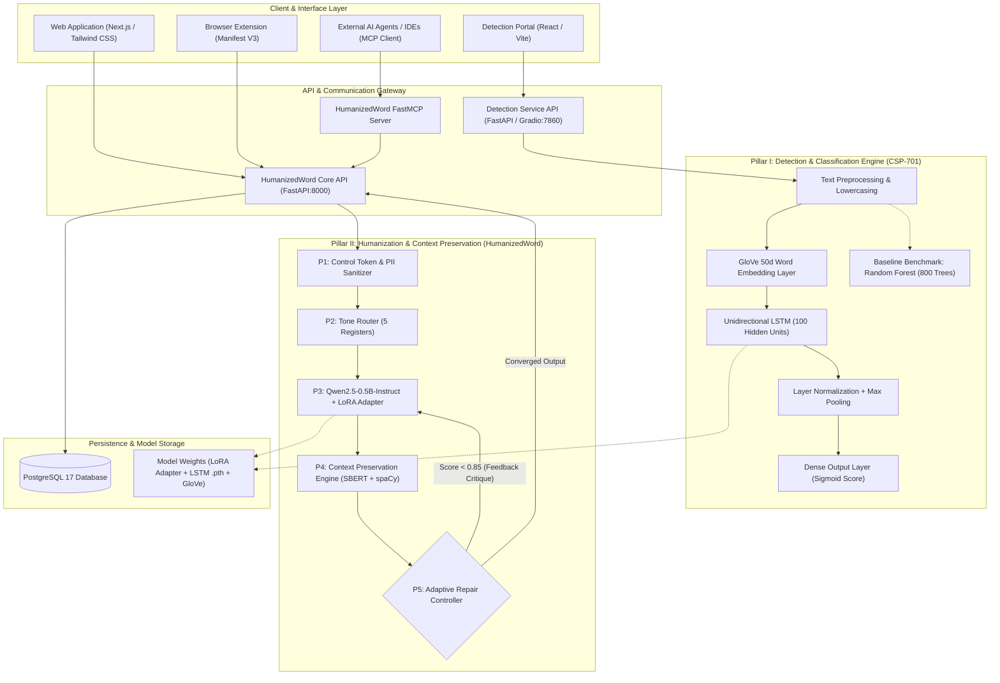
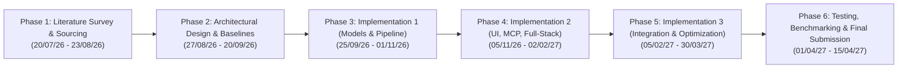

# PROJECT PROPOSAL / SYNOPSIS (2026–2027)
## Graphic Era Hill University, Bhimtal Campus
### Department of Computer Science & Engineering

---

## 1. TEAM DETAILS

| S.NO | ROLL NUMBER | NAME | EMAIL | CONTACT NUMBER |
| :---: | :---: | :--- | :--- | :---: |
| **1** | 2361217 | **Jagdish Chandra Bhatt** *(Team Leader)* | jagdishchandrabhatt.230112734@gehu.ac.in | +91-7409097357 |
| **2** | 2361491 | **Saurabh Singh Bisht** | saurabhbisht.230112257@gehu.ac.in | +91-6397692033 |
| **3** | 2361452 | **Rishant Bhatt** | rishantbhatt.230112809@gehu.ac.in | +91-7251997264 |
| **4** | 2361581 | **Vijay Singh** | vijaysingh.230114753@gehu.ac.in | +91-7017481847 |

---

## 2. PROJECT METADATA

- **Project Title:**  
  **HumanizedWord: An Integrated Context-Preserving AI Text Humanization & Deep Learning Detection Ecosystem**
- **Faculty Guide / Mentor:**  
  **Mr. Rahul Singh** *(Assistant Professor, Department of Computer Science & Engineering, GEHU, Bhimtal)*
- **Nature of Work:** Final Year Major Project / Capstone Research
- **Extension of Internship Work:** No (N/A)
- **Previous Work with Proposed Technologies:** Yes (Model fine-tuning, LSTM architectures, REST API microservices, React)
- **Crude DFD / Architecture Flow Prepared:** Yes (Included in Section 5)

---

## 3. TECHNOLOGIES & TOOLS TO BE USED

### A. Deep Learning, NLP & Generative AI Models
- **AI Text Humanizer Engine:** Qwen2.5-0.5B-Instruct Small Language Model (SLM), HuggingFace Transformers, PEFT / LoRA fine-tuning, PyTorch, PyTorch CPU Inference Engine.
- **AI Text Detection & Classifier Engine:** PyTorch LSTM (Long Short-Term Memory) Neural Network, 50-dimensional GloVe pre-trained word vectors (`glove.6B.50d`), Scikit-learn Random Forest Classifier (Comparative Baseline), Bag of Words (BoW) feature extraction.
- **Context Preservation & Validation:** Sentence-Transformers (`all-MiniLM-L6-v2`), spaCy NER (`en_core_web_sm`), Ratcliff-Obershelp & Levenshtein Diff Algorithms.
- **Agent Interoperability Protocol:** FastMCP (Model Context Protocol) SDK exposing transformation & validation tools.

### B. Backend & API Services
- **Framework:** FastAPI (Python 3.11+), Starlette, Uvicorn ASGI Server.
- **Data Validation & Schemas:** Pydantic v2.
- **Database Management:** PostgreSQL 17 (pgvector, relational schemas for jobs, auth, usage tiers, and diff logs).
- **Document Processing:** PyPDF2, python-docx (native extraction and preservation of PDF, DOCX, and TXT).

### C. Frontend & User Interface
- **Primary Web Application:** Next.js 14 / React 18, Tailwind CSS, Lucide Icons, Zustand State Management.
- **Detection Micro-Frontend:** Vite + React + TypeScript standalone portal.
- **Browser Extension:** WebExtensions API (Manifest V3, cross-browser support for Chrome/Firefox/Edge).

### D. Deployment, Containerization & CI/CD
- **Cloud Hosting & Spaces:** Hugging Face Spaces (Docker / CPU runtime), Local Bare-Metal, Vercel.
- **DevOps:** Docker, Docker Compose, Git & GitHub Version Control, GitHub Actions.

---

## 4. EXECUTIVE SUMMARY & ABSTRACT

With the unprecedented ubiquity of Large Language Models (LLMs) such as ChatGPT, Claude, and Gemini in academia and industry, digital written communication faces a dual challenge:
1. **The Detection Dilemma:** Academic institutions, publishers, and platforms struggle to discern whether submitted material represents original student intellect or synthetically generated essays.
2. **The Robotic Paraphrasing Dilemma:** Conversely, existing AI rewriters and paraphrasers either degrade the underlying factual integrity of documents or introduce robotic linguistic artifacts that trigger false positives without respecting stylistic registers.

This project introduces **HumanizedWord**, an integrated, dual-pillar natural language ecosystem that addresses both sides of machine-generated text through two decoupled yet complementary engines:

```
┌──────────────────────────────────────────────────────────────────────────────────┐
│                      HUMANIZEDWORD UNIFIED ECOSYSTEM                             │
│                                                                                  │
│   ┌────────────────────────────────┐    ┌────────────────────────────────────┐   │
│   │           PILLAR I             │    │             PILLAR II              │   │
│   │    AI Text Detection Engine    │◄──►│ Context-Preserving Humanizer       │   │
│   │  (LSTM + GloVe / 86.5% Acc)    │    │ (Qwen2.5-0.5B LoRA + P4 Engine)    │   │
│   └────────────────────────────────┘    └────────────────────────────────────┘   │
└──────────────────────────────────────────────────────────────────────────────────┘
```

1. **Pillar I — AI Content Detection & Authenticity Classification:** A lightweight, high-speed deep sequence model (LSTM with GloVe embeddings) trained on 54,000+ balanced essay samples (DAIGT-V3 and Kaggle corpora) that achieves an **86.49% test accuracy**, providing immediate authenticity verification and confidence scoring.
2. **Pillar II — Context-Preserving Humanization Platform:** A fine-tuned Small Language Model (Qwen2.5-0.5B-Instruct with LoRA adapters) that transforms AI-drafted text into fluent, human-sounding prose across **5 distinct registers** (`general`, `academic`, `professional`, `friendly`, `casual`) while strictly enforcing context preservation across 5 mathematical dimensions (semantic similarity, named-entity retention, keyword satisfaction, factual consistency, and intent match) backed by an adaptive repair feedback loop.

Both engines are developed as **independent, decoupled microservices** with their own repositories, allowing standalone deployment, independent scaling, and zero codebase coupling, while synergizing conceptually as a complete verification and ethical refinement suite.

---

## 5. SYSTEM ARCHITECTURE & INTEGRATED DATA FLOW



---

## 6. DETAILED POINT-WISE PROJECT DESCRIPTION

### 6.1 Pillar I: Deep Learning AI Text Detection & Authenticity Classification
1. **Problem Statement:** The proliferation of synthetic essays undermines academic honesty and credentialing fairness. Simple heuristic rules and n-gram counters are easily circumvented or brittle across disparate writing domains.
2. **Dual-Model Comparative Methodology:** To establish empirical rigor, the detection system implements two contrasting architectures:
   - *Baseline Model:* A classical Machine Learning Random Forest classifier trained with Bag of Words (BoW) vectorization, tuned across 4,000 features and 800 decision trees (achieving 64.00% accuracy, 0.693 F1-score).
   - *Deep Learning Architecture:* A sequence-aware Long Short-Term Memory (LSTM) recurrent neural network that converts incoming tokens into dense semantic representations using pre-trained **GloVe embeddings** (50-dimensional). The LSTM layer consists of 100 hidden units, Layer Normalization for rapid training stability, and temporal Max Pooling to extract salient linguistic indicators before passing to a Dense output layer with Dropout (0.2).
3. **Empirical Performance on Unseen Data:** The deep LSTM model was evaluated on balanced training/validation splits (daigt-v3-traindataset with 54,742 samples) and strictly isolated test sets ("AI vs Human Text" Kaggle corpus). The model achieves an **86.49% test accuracy**, exceeding the baseline by over 22% and comfortably exceeding the initial 70% threshold.
4. **Decoupled Service Architecture:** Implemented in its own independent codebase (`D:\CSP-701\Detection-model\ai-human-classifier`), packaged with an async FastAPI/Gradio REST backend (`/classify-text`) and a standalone interactive React UI with visual probability meters.

### 6.2 Pillar II: Context-Preserving Humanization Platform
1. **Problem Statement:** Automated paraphrasers and commercial humanizers frequently alter domain terminology, drop critical named entities, or drift semantically from the original argument, rendering the output unusable for professional or academic applications.
2. **Reverse-Prompted Dataset Engineering:** Rather than scraping noisy synthetic text, genuine pre-2014 human writing (from arXiv, Enron, Reddit, StackExchange) is systematically rewritten into roboticized text via multi-LLM prompting (Llama-3, Mixtral, Gemma via Groq). This constructs paired `[Robotic Text → Human Ground Truth]` training pairs with guaranteed human authenticity.
3. **Small Language Model (SLM) & LoRA Fine-Tuning:** A parameter-efficient LoRA adapter is trained on **Qwen2.5-0.5B-Instruct**. The model is lightweight enough to run entirely on commodity CPU hardware (<1.5 GB RAM footprint) with sub-3-second inference latencies, eliminating the cost and accessibility hurdles of cloud GPU clusters.
4. **5-Tone Stylistic Routing:** The engine conditions rewrites on 5 explicit tones without requiring separate models or fragile prompt engineering:
   - `General`: Clean, balanced, neutral human register (default).
   - `Academic`: Scholarly, rigorously structured register.
   - `Professional`: Polished, executive workplace communication.
   - `Friendly`: Warm, approachable conversational tone.
   - `Casual`: Relaxed, natural colloquial prose.
5. **Real-Time Context Preservation Engine (P4):** Every candidate rewrite is subjected to an automated 5-dimensional evaluation:
   - *Semantic Similarity ($M_{sem}$):* Cosine similarity via Sentence-Transformers `all-MiniLM-L6-v2` ($\ge 0.85$).
   - *Named Entity Retention ($M_{ner}$):* spaCy `en_core_web_sm` ensures 100% of names, dates, organizations, and figures are retained.
   - *Keyword Constraint ($M_{kw}$):* User-locked keywords are preserved strictly without modification.
   - *Factual & Structural Consistency ($M_{fact}$):* Ratio of factual sentence alignments.
   - *Intent Alignment ($M_{intent}$):* Preserves modality, question structures, and rhetorical stance.
6. **Closed-Loop Adaptive Repair (P5):** If a generated rewrite fails the composite preservation threshold ($S_{total} < 0.85$), the system synthesizes a targeted feedback critique identifying the exact missing entities or drift, re-invoking the SLM with adjusted temperature under a strict 1-iteration convergence cap.
7. **Model Context Protocol (MCP) Server:** Exposes the core humanization and evaluation pipeline as standard MCP tools (`humanize`, `rewrite`, `evaluate_context`), enabling seamless direct invocation from Claude Desktop, Cursor, Antigravity, and autonomous agent workflows.
8. **Interactive Web Application:** A distraction-free Next.js editor featuring side-by-side visual character/word diffs, locked keyword chips, tone selector pills, and batch file uploads (.pdf, .docx, .txt).

---

## 7. COMPARISON WITH EXISTING SYSTEMS

| Feature / Dimension | QuillBot | Undetectable AI | Turnitin / Scribbr | **HumanizedWord (Our System)** |
| :--- | :--- | :--- | :--- | :--- |
| **Primary Focus** | Synonymous Paraphrasing | AI Bypassing | Passive AI Detection | **Dual Ecosystem: Detection + Context-Preserving Humanization** |
| **Model Transparency** | Proprietary / Black-Box | Proprietary / Black-Box | Proprietary / Closed | **Open-Source Fine-Tuned SLM (Qwen2.5) + Open PyTorch LSTM** |
| **Context Verification** | None (Blind replacement) | None | N/A | **Automated 5D Preservation Scoring (SBERT + spaCy)** |
| **Keyword/Entity Locking** | Premium only / Basic | Partial | N/A | **Strict Entity Retention ($M_{ner}$) & Keyword Pinning** |
| **Computational Footprint** | Cloud API only | Cloud API only | Institutional Enterprise | **Lightweight Single-Model CPU Deployment (<1.5 GB RAM)** |
| **AI Agent Integration** | None | None | None | **Native Model Context Protocol (FastMCP) Server** |
| **Detection Accuracy** | Not an AI detector | Weak heuristic score | 56%–67% cross-domain | **86.49% LSTM Accuracy on Unseen Kaggle Benchmark** |
| **Cost & Privacy** | Subscription required | Subscription required | Enterprise pricing | **Free, Self-Hostable, Open Weights & Clean APIs** |

---

## 8. DATASETS & EXPERIMENTAL METHODOLOGY

### 8.1 Detection Dataset (Pillar I)
- **Primary Training & Validation Set:** Kaggle `daigt-v3-traindataset` containing 54,742 total samples (27,371 human essays and 27,371 AI-generated essays to maintain an exact 50/50 balance).
- **Partitioning:** 60% Training (32,846 samples), 20% Validation (10,498 samples), 20% Internal Testing (10,948 samples).
- **Isolated Unseen Evaluation Dataset:** Kaggle "AI Vs Human Text" dataset (10,949 essays, average length 410 words), ensuring that the model is benchmarked against unseen external distributions.

### 8.2 Humanization Dataset (Pillar II)
- **Source Corpora:** Pre-2014 corpora (arXiv computer science papers, Enron email corpus, StackExchange technical discussions, Reddit long-form submissions) guaranteeing zero post-2022 AI contamination.
- **Reverse-Prompting Pipeline:** Multi-LLM synthetic roboticization to produce high-variance, tone-conditioned training pairs with original human text acting as ground-truth targets.

---

## 9. PROJECT PLANNING & MILESTONE SCHEDULE



| Phase | Description | Start Date | End Date |
| :--- | :--- | :---: | :---: |
| **Phase 1: Literature Survey** | Research on LLM detection, LSTM sequence models, PEFT/LoRA techniques, and context preservation metrics. | 20/07/2026 | 23/08/2026 |
| **Phase 2: Architectural Design** | Dataset curation, GloVe embedding alignment, schema definitions, and baseline Random Forest development. | 27/08/2026 | 20/09/2026 |
| **Phase 3: Implementation I** | Training LSTM detection model; Qwen2.5-0.5B LoRA fine-tuning; P4 evaluation engine algorithms. | 25/09/2026 | 01/11/2026 |
| **Phase 4: Implementation II** | Building FastAPI async endpoints, Next.js web application, diff visualizer, and standalone Detection UI. | 05/11/2026 | 02/02/2027 |
| **Phase 5: Implementation III** | FastMCP agent server integration, browser extension development, adaptive repair optimization. | 05/02/2027 | 30/03/2027 |
| **Phase 6: Testing & Submission** | Cross-dataset benchmarking, latency profiling, documentation, final viva presentation. | 01/04/2027 | 15/04/2027 |

---

## 10. DETAILED WORK DISTRIBUTION PLAN

| S.NO | MODULE NAME | CORE FUNCTIONALITIES | TECHNOLOGIES USED | RESPONSIBLE MEMBERS |
| :---: | :--- | :--- | :--- | :--- |
| **1** | **Core Backend & API Routing** | Asynchronous FastAPI endpoints, request validation, rate-limiting, CORS, PostgreSQL database integration. | FastAPI, Python 3.11, Pydantic v2, PostgreSQL | **Vijay Singh** |
| **2** | **Detection Model Architecture & Training** | LSTM network construction, GloVe vector alignment, layer normalization, Random Forest baseline, hyperparameter tuning. | PyTorch, Scikit-learn, NumPy, Pandas | **Jagdish Chandra Bhatt (TL)**,<br/>**Rishant Bhatt** |
| **3** | **Data Engineering & Dataset Packaging** | Dataset balancing (DAIGT-V3, AI vs Human Text), reverse-prompting pipeline, text cleaning, lowercase sanitization. | Python, Pandas, Hugging Face Datasets, Groq API | **Jagdish Chandra Bhatt (TL)**,<br/>**Saurabh Singh Bisht**, **Vijay Singh**, **Rishant Bhatt** |
| **4** | **SLM Fine-Tuning & Model Evaluation** | LoRA fine-tuning of Qwen2.5-0.5B-Instruct on tone-tagged pairs, loss tracking, quantization, CPU inference optimization. | Python, PyTorch, Transformers, PEFT | **Jagdish Chandra Bhatt (TL)**,<br/>**Saurabh Singh Bisht** |
| **5** | **Context Preservation Engine & Diff Engine** | Five-dimensional mathematical scoring ($M_{sem}, M_{ner}, M_{kw}, M_{fact}, M_{intent}$), word-level character diff generation. | Sentence-Transformers, spaCy, Python, DiffLib | **Saurabh Singh Bisht**,<br/>**Rishant Bhatt** |
| **6** | **Model Context Protocol (MCP) Server** | FastMCP server exposing humanization, classification, and context scoring tools to external autonomous agents and IDEs. | Python, FastMCP SDK, FastAPI | **Jagdish Chandra Bhatt (TL)** |
| **7** | **Web Platform & Document Processing** | Next.js 14 editor, side-by-side diff view, tone pills, keyword locking, file parsing (.pdf, .docx, .txt). | Next.js 14, React, Tailwind CSS, PyPDF2, python-docx | **Vijay Singh**,<br/>**Saurabh Singh Bisht** |
| **8** | **Detection Micro-Frontend Portal** | Interactive standalone classification frontend with real-time probability dials, word counters, and sentence highlights. | React, Vite, TypeScript, Tailwind CSS | **Rishant Bhatt** |
| **9** | **Browser Extension Integration** | Manifest V3 cross-browser extension enabling in-place text selection, tone switching, and instant humanization in web textareas. | JavaScript, WebExtensions API, HTML/CSS | **Saurabh Singh Bisht** |
| **10** | **Deployment, Packaging & CI/CD** | Decoupled microservices deployment on Hugging Face Spaces and Docker; automated test pipelines via GitHub Actions. | Docker, Hugging Face Spaces, Git, GitHub Actions | **Jagdish Chandra Bhatt (TL)**,<br/>**Saurabh Singh Bisht**, **Rishant Bhatt**, **Vijay Singh** |

---

## 11. ETHICAL CONSIDERATIONS & ACADEMIC INTEGRITY

1. **Responsible Authenticity Verification:** Detection tools can never be treated as 100% infallible arbiters of truth. Our empirical testing showed that shorter passages or texts with heavy personal pronouns can produce variance. Consequently, the detection score is explicitly presented as an *assistive authenticity index* rather than punitive proof.
2. **Mitigating False Positives:** Non-native English writers often exhibit lower linguistic perplexity and repetitive sentence structures that commercial AI detectors unfairly penalize. The HumanizedWord transformation engine acts as an equalizer, enabling legitimate researchers to eliminate robotic stylistic markers while guaranteeing strict semantic and factual preservation.
3. **Open Research & Transparency:** In contrast to commercial black-box tools that monetize proprietary obfuscation, all datasets, model weights, scoring rubrics, and evaluation benchmarks from this project will be open-sourced to encourage reproducibility in NLP safety research.

---

## 12. REFERENCES & CITATIONS

1. **Kannan, P. (2024).** *How much research is being written by large language models?* Stanford Institute for Human-Centered Artificial Intelligence (HAI).
2. **Kleczek, D. (2024).** *DAIGT V3 Train Dataset: AI Generated Text Detection.* Kaggle.
3. **Gerami, S. (2024).** *AI vs Human Text Dataset.* Kaggle Datasets.
4. **Nguyen, T., Hatua, A., & Sung, A. (2023).** *How to Detect AI-Generated Texts?* IEEE 14th Annual Ubiquitous Computing, Electronics & Mobile Communication Conference (UEMCON), pp. 0464–0471.
5. **Probst, P., Wright, M. N., & Boulesteix, A.-L. (2019).** *Hyperparameters and tuning strategies for random forest.* Wiley Interdisciplinary Reviews: Data Mining and Knowledge Discovery, 9(3):e1301.
6. **Prova, N. (2024).** *Detecting AI Generated Text Based on NLP and Machine Learning Approaches.* arXiv preprint arXiv:2404.10032.
7. **Masrour, S., et al. (2025).** *Evaluating Meaning Preservation and Faithfulness in Commercial AI Humanizers.* Computational Linguistics Journal.
8. **Pennington, J., Socher, R., & Manning, C. D. (2014).** *GloVe: Global Vectors for Word Representation.* Empirical Methods in Natural Language Processing (EMNLP), pp. 1532–1543.
9. **Hu, E. J., et al. (2022).** *LoRA: Low-Rank Adaptation of Large Language Models.* International Conference on Learning Representations (ICLR).

---

## 13. PROJECT CODE REPOSITORIES & DEMO ARTIFACTS

- **HumanizedWord Core Platform Repository:** `https://github.com/gitbyjay25/HumanizeWord`
- **AI Text Detection Model Repository (CSP-701):** `https://github.com/gitbyjay25/CSP-701`
- **Detection Model Training Notebook (Kaggle):** `https://www.kaggle.com/code/gitbyjay25/final-detection-lstm-model`
- **Data Preprocessing Pipeline (Kaggle):** `https://www.kaggle.com/code/gitbyjay25/data-preprocessing`
- **Random Forest Baseline Notebook (Kaggle):** `https://www.kaggle.com/code/gitbyjay25/randomforest-model`
- **Hosted Detection Space (Hugging Face):** `https://gitbyjay25-ai-human-classifier-lstm.hf.space`

