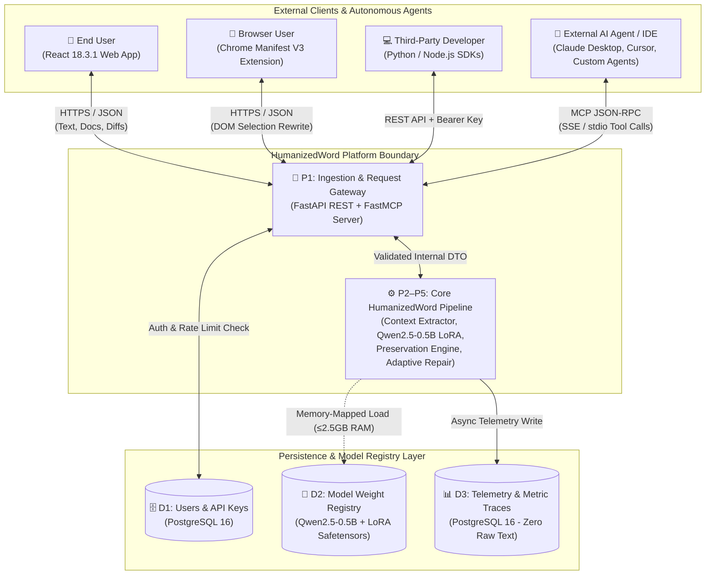
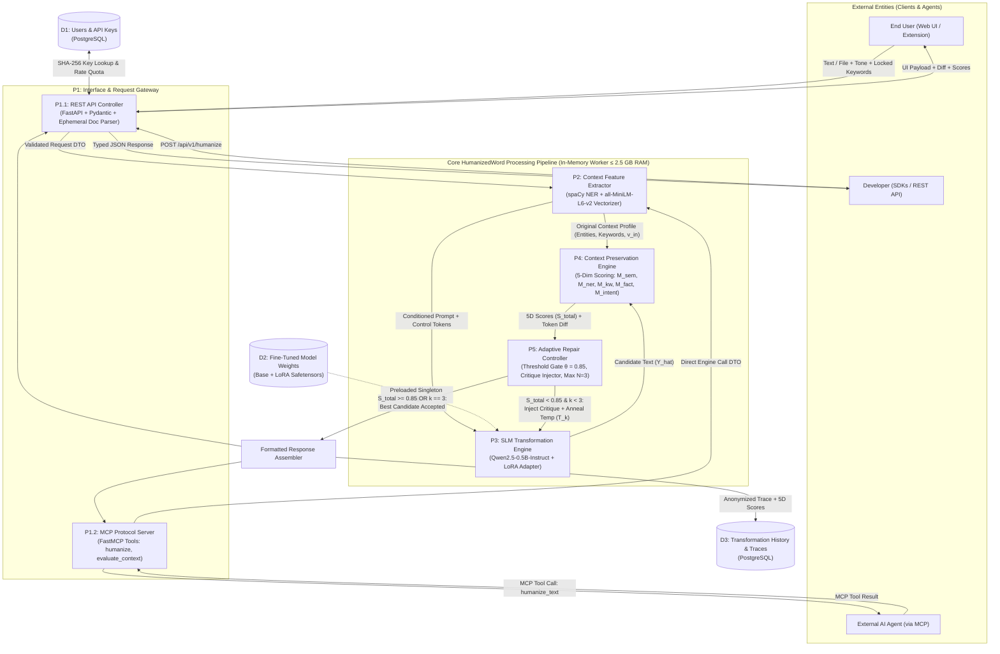
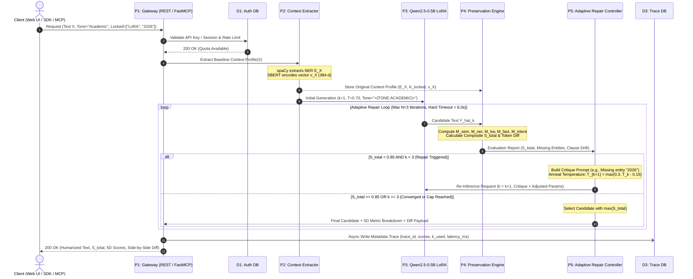
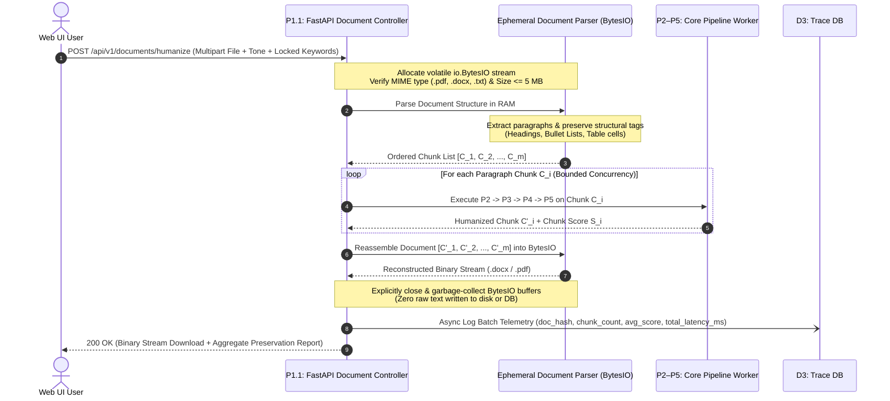
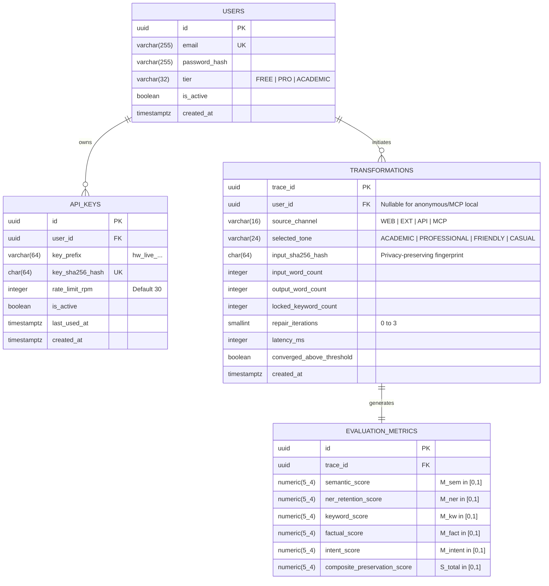

# High-Level Design (HLD): HumanizedWord

**Document ID:** `docs/02_HLD.md`  
**Paired Specification:** `docs/01_PRD.md` (v1.0.0)  
**Project Classification:** Final Year B.Tech CSE Major Project (2026–2027)  
**Architecture Style:** Hybrid Multi-Client Gateway + Closed-Loop SLM Inference Pipeline  

---

## 1. Architectural Constraints & Pinned Technology Stack

### 1.1 Core Architectural Constraints
1. **Hybrid Topology (Client UIs + API/MCP Gateway + ML Inference):**
   * The system decouples presentation clients (React Web UI, Manifest V3 Browser Extension, Python/Node.js SDKs, and External MCP Agents) from the compute-intensive NLP pipeline via a dual-protocol Ingestion Gateway (**P1.1 REST API Controller** and **P1.2 FastMCP Server**).
2. **CPU-Deployable Memory Bound ($\le 2.5\text{ GB}$ RAM):**
   * To ensure free-tier/low-cost cloud deployability (e.g., Hugging Face Spaces CPU Basic 2 vCPU / 16 GB RAM or constrained Docker containers), the entire ML worker footprint must stay strictly $\le 2.5\text{ GB}$ resident set size (RSS).
   * Achieved by loading `Qwen/Qwen2.5-0.5B-Instruct` ($490\text{M}$ parameters) in `bfloat16`/`float16` or 8-bit dynamic quantization ($\sim 1.05\text{ GB}$), shared across a single merged/hot-swappable **PEFT LoRA adapter** ($\sim 18\text{ MB}$), `all-MiniLM-L6-v2` ($\sim 90\text{ MB}$), and `en_core_web_sm` spaCy pipeline ($\sim 45\text{ MB}$).
3. **Ephemeral Document & Text Buffering (Zero Raw Text Persistence):**
   * Raw user-submitted text and uploaded `.pdf`/`.docx`/`.txt` files are processed exclusively in volatile in-memory buffers (`io.BytesIO`).
   * **D3 (Transformation History & Traces)** logs only anonymized telemetry, cryptographic hashes of inputs, token counts, latency traces, and the 5-dimensional evaluation scores—**never** persisting raw user passages or uploaded documents to disk.

### 1.2 Pinned Technology Stack

| Layer | Component | Pinned Version | Architectural Role |
| :--- | :--- | :--- | :--- |
| **Core Runtime** | Python | `3.11.9+` | Asynchronous backend runtime & ML orchestration |
| **API & Agent Gateway** | FastAPI / Pydantic | `0.115.x` / `2.9.x` | P1.1 REST API Controller, schema validation, OpenAPI docs |
| **MCP Server** | FastMCP (`mcp` SDK) | `1.2.x` | P1.2 Model Context Protocol server (stdio & SSE transport) |
| **SLM & Fine-Tuning** | PyTorch / Transformers / PEFT | `2.4.x` / `4.45.x` / `0.13.x` | P3 Qwen2.5-0.5B-Instruct inference & LoRA weight injection |
| **Semantic Engine** | `sentence-transformers` | `3.1.x` (`all-MiniLM-L6-v2`) | P2 & P4 Siamese bi-encoder embeddings ($384$-d vectors) |
| **Linguistic & NER Engine** | `spaCy` | `3.7.x` (`en_core_web_sm`) | P2 & P4 Named Entity Recognition, POS, dependency parsing |
| **Document Parsing** | `PyPDF2` / `python-docx` | `3.0.x` / `1.1.x` | In-memory PDF and DOCX paragraph chunking & reconstruction |
| **Web Frontend** | React / Tailwind CSS / Vite | `18.3.1` / `3.4.x` / `5.4.x` | Split-pane distraction-free editor, visual diff, radial gauges |
| **Browser Extension** | Chrome WebExtensions API | `Manifest V3` | Content script DOM text selection & floating rewrite widget |
| **Database** | PostgreSQL / SQLAlchemy | `16.x` / `2.0.x (asyncpg)` | Persistent storage for D1 (Users/Keys) and D3 (Metric Traces) |

---

## 2. Architectural Diagrams (Mermaid)

### 2.1 System Context Diagram (C4 Level 1)
Illustrates how external actors and autonomous agents interact with the **HumanizedWord Platform** and its backing data stores.



---

### 2.2 Container & Pipeline Data Flow Diagram (C4 Level 2 / P1–P5 Alignment)
Details the internal container boundaries and exact data flow across **P1 through P5** and **D1 through D3**.



---

### 2.3 Sequence Diagram 1: Real-Time Text Humanization with P5 Adaptive Repair Loop
Demonstrates the closed-loop feedback cycle when a candidate rewrite initially fails context preservation ($S_{\text{total}} < \theta$) and undergoes targeted critique injection up to $N_{\text{max}} = 3$ retries within the $6.0\text{s}$ timeout budget.



---

### 2.4 Sequence Diagram 2: Ephemeral Document Batch Processing
Shows how `.pdf` and `.docx` uploads are chunked, processed through the pipeline in memory, reassembled with structural formatting preserved, and purged immediately without disk persistence.



---

## 3. State & Data Model Specification

### 3.1 Entity-Relationship Diagram (PostgreSQL 16 — D1 & D3)
Raw user input/output strings are intentionally omitted from `transformations` in **D3** to enforce the ephemeral privacy constraint. Only SHA-256 content hashes and character/token counts are stored.



### 3.2 Model Registry Structure (D2)
Stored on Hugging Face Hub (`humanizedword/qwen2.5-0.5b-tone-lora`) and cached in a read-only local Docker volume (`/models`):

```text
/models/qwen2.5-0.5b-humanizer-v1/
├── base_model/                          # Frozen Qwen/Qwen2.5-0.5B-Instruct weights
│   ├── config.json
│   ├── generation_config.json
│   ├── model.safetensors                # FP16 / BF16 weights (~990 MB)
│   ├── tokenizer.json
│   └── tokenizer_config.json            # Includes custom tone control tokens
├── lora_adapters/
│   ├── adapter_config.json              # r=16, lora_alpha=32, target_modules=[q,k,v,o,gate,up,down]
│   ├── adapter_model.safetensors        # Unified multi-tone LoRA weights (~18 MB)
│   └── training_metrics.json            # Validation BERTScore & loss curves
└── embeddings/
    └── all-MiniLM-L6-v2/                # Pre-cached Sentence-Transformer weights (~90 MB)
```

---

## 4. Security, Privacy & Performance Engineering

### 4.1 Data Classification & Ephemeral Processing Policy

| Data Artifact | Classification | Storage Policy | Retention Window |
| :--- | :--- | :--- | :--- |
| **Raw Input / Output Text** | Confidential User Content | Volatile RAM only (`str` / `BytesIO`) | $0\text{ ms}$ post-response (Immediate GC) |
| **Uploaded Documents (`.pdf`/`.docx`)** | Confidential User Content | In-memory `SpooledTemporaryFile(max_size=5MB)` | Purged in `finally` block prior to HTTP return |
| **Training Dataset Corpora** | Public Pre-2014 Ground Truth | Scrubbed via spaCy NER + Regex PII filters | Versioned on HF Datasets |
| **API Keys** | Secret Credential | Salted SHA-256 hash in PostgreSQL (**D1**) | Until revoked by user |
| **Transformation Telemetry** | Operational Metadata | PostgreSQL (**D3**) — numerical scores & hashes only | 90 days rolling retention |

### 4.2 Security Controls
1. **Authentication & Key Hashing:**
   * Web sessions use `HttpOnly`, `SameSite=Strict` JWTs.
   * Developer SDK keys (`hw_live_<32_random_chars>`) are never stored in plaintext; P1.1 computes `hashlib.sha256(raw_key).hexdigest()` and performs a constant-time lookup against `API_KEYS.key_sha256_hash`.
2. **Sliding-Window Rate Limiting:**
   * Enforced at **P1.1** via an in-memory token bucket (or Redis in multi-replica deployments): `30 RPM` for authenticated SDK/Web users, `10 RPM` for unauthenticated demo requests, and max payload cap of `1,500 words` per synchronous call.
3. **Prompt Injection & Control Token Sanitization:**
   * **P2** strips reserved control tokens (`<|TONE:...|>` and `[CRITIQUE]`) and special chat template delimiters (`<|im_start|>`, `<|im_end|>`) from raw user text before prompt assembly to prevent system prompt hijacking.

### 4.3 Performance & Resource Budgets

| Metric / Resource | Target Budget | Hard Ceiling | Enforcement Mechanism |
| :--- | :--- | :--- | :--- |
| **Single-Pass Latency ($k=1$, 250 words)** | $\le 1.4\text{ s}$ | $\le 1.8\text{ s}$ | `torch.inference_mode()`, KV-cache enabled, preloaded singleton models |
| **Adaptive Repair Loop Total Latency ($k \le 3$)** | $\le 4.2\text{ s}$ | $6.0\text{ s}$ | `asyncio.wait_for(..., timeout=6.0)` inside **P5**; returns best candidate on timeout |
| **Context Engine Evaluation Overhead (P2 + P4)** | $\le 120\text{ ms}$ | $\le 200\text{ ms}$ | Batched SBERT cosine calculation + disabled unused spaCy parser components |
| **Worker Container Memory Footprint** | $\le 2.1\text{ GB}$ | $\le 2.5\text{ GB}$ | Single process with `--workers 1` async event loop + `float16`/`int8` weights |

---

## 5. DevOps, Monorepo Layout & Traceability Matrix

### 5.1 Pinned Monorepo Directory Structure

```text
humanizedword/
├── docs/
│   ├── 01_PRD.md                        # Product Requirements Document
│   └── 02_HLD.md                        # High-Level Design (This Document)
├── backend/                             # Python 3.11+ FastAPI + FastMCP + P2-P5 Pipeline
│   ├── app/
│   │   ├── api/                         # P1.1: REST routers (/humanize, /evaluate, /documents)
│   │   ├── mcp_server/                  # P1.2: FastMCP tool definitions & stdio/SSE entrypoints
│   │   ├── pipeline/
│   │   │   ├── p2_extractor.py          # spaCy NER + SBERT baseline profiler
│   │   │   ├── p3_slm_engine.py         # Qwen2.5-0.5B-Instruct + PEFT LoRA singleton
│   │   │   ├── p4_preservation.py       # 5-Dimensional Context Preservation Engine
│   │   │   └── p5_adaptive_repair.py    # Closed-loop critique injector & temp annealing
│   │   ├── db/                          # SQLAlchemy 2.0 async models (D1 & D3)
│   │   └── core/                        # Config, security, rate limiter, ephemeral doc parser
│   ├── tests/                           # Pytest unit, PAWS adversarial, and latency benchmarks
│   ├── Dockerfile
│   └── pyproject.toml
├── web/                                 # React 18.3.1 + Tailwind 3.4 + Vite Frontend
│   ├── src/
│   │   ├── components/                  # SplitEditor, DiffViewer, RadialScoreGauge, KeywordLockInput
│   │   ├── services/                    # Typed REST API client
│   │   └── App.tsx
│   ├── package.json
│   └── tailwind.config.js
├── extension/                           # Chrome Manifest V3 Companion Extension
│   ├── manifest.json
│   ├── background.js
│   ├── content_script.js                # Floating selection badge & in-place DOM replacement
│   └── popup/
├── sdks/                                # Official Developer SDKs
│   ├── python/                          # pip-installable humanizedword-sdk
│   └── nodejs/                          # npm-installable @humanizedword/sdk
├── model_training/                      # Offline Data Engineering & LoRA Fine-Tuning
│   ├── dataset_pipeline/                # Pre-2014 corpus cleaners + Groq API roboticizer
│   ├── train_lora.py                    # Hugging Face PEFT / SFTTrainer script
│   └── evaluate_benchmarks.py           # RAID, PAWS, and BERTScore evaluation suite
└── docker-compose.yml                   # Local full-stack orchestration
```

### 5.2 Build, Test & Deployment Commands

```bash
# 1. Local Full-Stack Development (Backend + PostgreSQL 16 + React Web UI)
docker compose up --build -d

# 2. Run Backend Unit Tests, PAWS Adversarial Suite & Memory Budget Check
cd backend && pytest tests/ -v --cov=app

# 3. Start Standalone FastMCP Server for Claude Desktop / Cursor IDE Inspection
cd backend && fastmcp dev app/mcp_server/server.py

# 4. Build React 18.3.1 Production Bundle
cd web && npm ci && npm run build

# 5. Deploy Containerized CPU Space to Hugging Face Spaces
git push https://huggingface.co/spaces/humanizedword/platform main
```

---

### 5.3 Functional Requirements (PRD) to HLD Component Traceability Matrix

| PRD Requirement ID | Requirement Summary (from `docs/01_PRD.md`) | HLD Pipeline Stage / Module | Verification Method |
| :--- | :--- | :--- | :--- |
| **FR-01: Tone-Conditioned Rewriting** | Support 4 selectable tones (`Academic`, `Professional`, `Friendly`, `Casual`) on a single SLM | **P3** (`p3_slm_engine.py`) + **D2** LoRA Adapter | Style classifier benchmark & unit tests |
| **FR-02: Reverse-Prompted Dataset** | Pre-2014 human corpora roboticized via Groq multi-LLM pipeline with PII scrubbing | `model_training/dataset_pipeline/` | HF Dataset schema & zero-PII audit |
| **FR-03: 5D Context Preservation** | Score Semantic Similarity, NER Retention, Locked Keywords, Factual & Intent alignment | **P2** (`p2_extractor.py`) + **P4** (`p4_preservation.py`) | PAWS adversarial test suite & SBERT cosine checks |
| **FR-04: Adaptive Repair Loop** | Trigger critique-guided re-inference with temperature annealing when $S_{\text{total}} < 0.85$ (max $N=3$) | **P5** (`p5_adaptive_repair.py`) | Ablation study ($k=0,1,2,3$) & $6.0\text{s}$ timeout test |
| **FR-05: MCP Agent Server** | Expose `humanize_text`, `evaluate_context_loss`, and `batch_rewrite_document` via MCP | **P1.2** (`app/mcp_server/server.py`) | FastMCP Inspector & agent tool-call integration test |
| **FR-06: Distraction-Free Web UI & Diff** | Split-pane React editor, keyword locking, side-by-side token diff, and 5D radial score gauges | `/web/src/components/` + **P1.1** (`app/api/`) | End-to-end Playwright UI tests |
| **FR-07: Batch Document Processing** | Parse `.pdf`, `.docx`, `.txt` in volatile memory and reconstruct formatted documents | **P1.1** (`app/core/doc_parser.py`) | Memory leak profiling & zero-disk-write assertion |
| **FR-08: Browser Extension** | Manifest V3 content script for in-place DOM selection humanization | `/extension/content_script.js` + **P1.1** | Chrome Extension Manifest V3 integration test |
| **NFR-01: CPU Memory & Latency** | $\le 2.5\text{ GB}$ RAM footprint and $\le 1.8\text{ s}$ single-pass latency on CPU | **P3** Singleton + Docker resource limits | `docker stats` RSS check & Locust load benchmark |