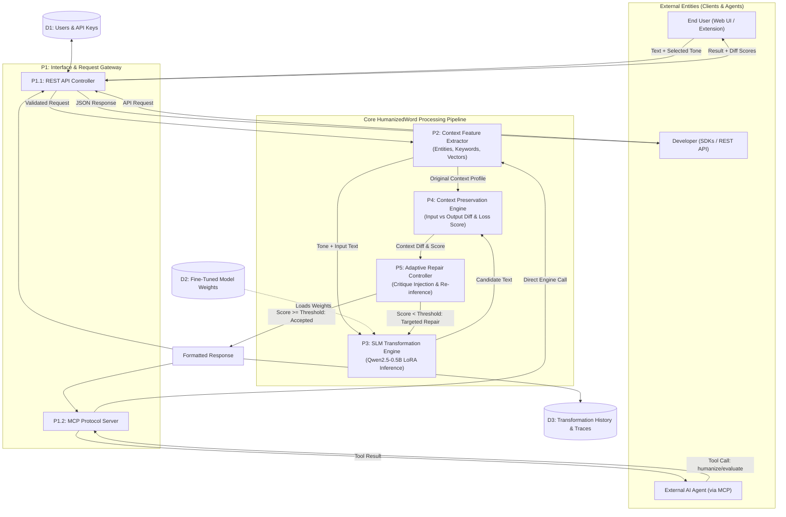

# Product Requirements Document (PRD): HumanizedWord

**Document Version:** 1.0.0  
**Project Classification:** Final Year B.Tech CSE Major Project (2026–2027)  
**System Paradigm:** Context-Aware, Tone-Conditioned Small Language Model (SLM) Rewriting & Agentic Evaluation Platform

---

## 1. Executive Summary & Project Vision

**HumanizedWord** is an open-source, context-aware SaaS platform, developer ecosystem, and Model Context Protocol (MCP) agent server engineered to transform robotic, LLM-generated text into natural, human-sounding prose while strictly preserving semantic meaning, factual consistency, named entities, and authorial intent. 

While commercial AI humanizers and paraphrasing platforms (such as QuillBot, Undetectable AI, and HumanizedText.pro) operate as closed-source black boxes, empirical audits demonstrate that existing humanizers frequently suffer from severe semantic drift, hallucinated facts, and corrupted named entities. HumanizedWord bridges this gap by combining a parameter-efficient fine-tuned Small Language Model (**Qwen2.5-0.5B-Instruct via LoRA**) with a deterministic/neural **Context Preservation Engine** and a closed-loop **Adaptive Repair Controller**. 

The platform exposes its pipeline across four unified interfaces: a distraction-free Web Application with document processing, an in-place Browser Extension, RESTful APIs with Python/Node.js SDKs, and a standardized MCP Server for autonomous AI agents.

---

## 2. Problem Statement & Literature Grounding

### 2.1 Core Technical Challenges
1. **The Paraphrase Quality vs. Diversity Trade-off:** As established in controlled paraphrase generation literature (*Bandel et al., 2022 - QCPG*), increasing lexical and syntactic diversity to sound natural exponentially increases the risk of degrading semantic meaning.
2. **Surface-Form vs. Contextual Equivalence:** Traditional n-gram metrics fail to capture compositional meaning or detect word-order inversions. As shown in *PAWS (Zhang et al., 2019)*, sentences with high lexical overlap can have opposite meanings (e.g., *"Flights from New York to Florida"* vs. *"Flights from Florida to New York"*). Conversely, valid human-like rewrites require deep contextual token alignment (*Zhang et al., 2020 - BERTScore*) and rapid Siamese bi-encoder vector comparison (*Reimers & Gurevych, 2019 - Sentence-BERT*).
3. **Fragility of Unchecked Humanizers:** Recent benchmarks on adversarial text modification (*Masrour et al., 2025 - DAMAGE*; *Dugan et al., 2024 - RAID*) highlight that existing AI humanizers routinely sacrifice output faithfulness, alter domain terminology, or inject grammatical artifacts to alter perplexity and burstiness.
4. **Compute & Deployment Bottlenecks:** Deploying separate full-parameter LLMs for distinct writing styles (*Jin et al., 2021 - Text Style Transfer Survey*) is computationally prohibitive. Utilizing Low-Rank Adaptation (*Hu et al., 2021 - LoRA*) on a sub-billion parameter model enables multi-tone conditioning on CPU/edge-grade cloud hardware without inference latency overhead.

---

## 3. System Architecture & Data Flow Specification

The system architecture follows a modular, closed-loop feedback pipeline divided into five core processing stages (**P1–P5**) and three persistent data stores (**D1–D3**):

### 3.1 Architecture Flowchart (Mermaid)

### 3.2 Ingestion & Request Gateway (P1)
* **P1.1 REST API Controller:** Built on asynchronous FastAPI. Handles authentication, API key validation against **D1 (Users & API Keys Store)**, rate limiting, and payload validation for the Web UI, Browser Extension, and Developer SDKs.
* **P1.2 MCP Protocol Server:** Built using the FastMCP Python SDK. Exposes standardized JSON-RPC tools (`humanize`, `rewrite`, `tone_transfer`, `evaluate_context`) over stdio/SSE so external AI agents and IDEs can invoke the pipeline natively.

### 3.3 Core HumanizedWord Processing Pipeline (P2–P5)
* **P2: Context Feature Extractor:** Parses raw input text prior to generation. Uses **spaCy** to extract Named Entities (NER), numerical figures, and user-specified locked keywords, while **Sentence-Transformers (`all-MiniLM-L6-v2`)** computes the baseline dense semantic embedding vector $\vec{v}_{\text{in}}$. Generates the **Original Context Profile**.
* **P3: SLM Transformation Engine:** Loads frozen base weights of **Qwen2.5-0.5B-Instruct** alongside tone-conditioned **PEFT/LoRA** adapter weights from **D2 (Fine-Tuned Model Weights)**. Executes conditioned generation using control tokens (`<|TONE:ACADEMIC|>`, `<|TONE:PROFESSIONAL|>`, `<|TONE:FRIENDLY|>`, `<|TONE:CASUAL|>`) and protected entity constraints to produce a **Candidate Text**.
* **P4: Context Preservation Engine:** Evaluates the **Candidate Text** against the **Original Context Profile** across five mathematical dimensions, producing a token-level Input-vs-Output Diff and a composite **Context Preservation Score ($S_{\text{total}}$)**.
* **P5: Adaptive Repair Controller:** Acts as a quality gate.
  * **Acceptance Path ($S_{\text{total}} \ge \theta$):** If the candidate meets or exceeds the preservation threshold $\theta$, it is formatted, logged to **D3 (Transformation History & Traces)**, and returned to P1.
  * **Targeted Repair Path ($S_{\text{total}} < \theta$):** If the candidate fails validation (e.g., dropped an entity or drifted semantically), P5 constructs a structured **Critique Prompt** detailing the exact missing entities or drifted clauses, adjusts decoding hyperparameters (lowering temperature, adjusting repetition penalty), and routes the request back to **P3** for re-inference under a strict convergence cap ($N_{\text{max}} = 3$ iterations).

---

## 4. Deep-Dive Module Specifications (Major Project Rigor)

### 4.1 Reverse-Prompting Dataset Engineering Pipeline
To avoid training on synthetic "human-like" LLM outputs, the dataset is constructed via **Reverse-Prompting** using verifiable pre-LLM human ground truth:
1. **Corpus Sourcing (Pre-2014 Ground Truth):** Extract clean, human-authored text across four domain-aligned sources: **arXiv** (Academic), **Enron Email Dataset** (Professional), **StackExchange** (Friendly/Informative), and **Reddit** (Casual).
2. **PII Scrubbing & Normalization:** Automated regex and spaCy NER scrubbing to strip personal identifiable information, broken markup, and non-textual artifacts.
3. **Multi-LLM Roboticization (Groq API):** Human ground-truth passages ($Y_{\text{human}}$) are passed through high-speed LLMs via the Groq API using system prompts that instruct the LLM to rewrite the passage in a rigid, standard, high-perplexity-uniformity "AI assistant" style ($X_{\text{robotic}}$) while retaining all facts.
4. **Inverted Pair Packaging:** Pairs are inverted into training tuples:
   $$\text{Input: } (\text{Tone Tag}, \text{Locked Entities}, X_{\text{robotic}}) \longrightarrow \text{Target: } Y_{\text{human}}$$
   Packaged and versioned on Hugging Face Datasets with stratified 80/10/10 train/validation/test splits.

### 4.2 SLM Fine-Tuning & LoRA Architecture (P3)
* **Base Model:** `Qwen/Qwen2.5-0.5B-Instruct` (490M parameters, 32k context window, grouped-query attention).
* **LoRA Configuration:** Low-Rank Adaptation applied to all linear attention and MLP projection layers (`q_proj`, `k_proj`, `v_proj`, `o_proj`, `gate_proj`, `up_proj`, `down_proj`) with rank $r = 16$, scaling factor $\alpha = 32$, and dropout $p = 0.05$.
* **Training Objective:** Causal Language Modeling cross-entropy loss computed strictly over target response tokens (masking prompt tokens), optimized via `AdamW` with cosine learning rate decay and early stopping based on validation BERTScore.

### 4.3 Context Preservation Engine & Scoring Formulation (P4)
Every candidate generation $\hat{Y}$ is evaluated against input $X$ across five normalized sub-metrics $\in [0, 1]$:
1. **Semantic Similarity ($M_{\text{sem}}$):** Cosine similarity between SBERT (`all-MiniLM-L6-v2`) embeddings:
   $$M_{\text{sem}} = \frac{\vec{v}_X \cdot \vec{v}_{\hat{Y}}}{\|\vec{v}_X\| \|\vec{v}_{\hat{Y}}\|}$$
2. **Named-Entity Retention ($M_{\text{ner}}$):** Exact and fuzzy recall of spaCy extracted entities $E_X$ (persons, organizations, dates, numbers, locations) in $\hat{Y}$:
   $$M_{\text{ner}} = \frac{|E_X \cap E_{\hat{Y}}|}{|E_X|}$$
3. **Keyword Constraint Satisfaction ($M_{\text{kw}}$):** Binary/proportional check verifying that 100% of user-locked keywords $K_{\text{locked}}$ appear unaltered in $\hat{Y}$.
4. **Factual & Structural Consistency ($M_{\text{fact}}$):** Penalizes negation flips, antonym substitution, and dependency-tree role inversions (inspired by PAWS adversarial checks).
5. **Intent & Tone Alignment ($M_{\text{intent}}$):** Evaluates sentence modality (interrogative, declarative, imperative preservation) and lexical readability shifts.

**Composite Context Preservation Score ($S_{\text{total}}$):**
$$S_{\text{total}} = w_1 M_{\text{sem}} + w_2 M_{\text{ner}} + w_3 M_{\text{kw}} + w_4 M_{\text{fact}} + w_5 M_{\text{intent}}$$
*(Default weights: $w_1 = 0.35, w_2 = 0.25, w_3 = 0.20, w_4 = 0.10, w_5 = 0.10$; Default acceptance threshold $\theta = 0.85$).*

### 4.4 Adaptive Repair Controller (P5)
When $S_{\text{total}} < 0.85$, P5 triggers an automated repair loop (capped at $k \le 3$ attempts):
* **Diagnostic Extraction:** Identifies which specific sub-metric failed (e.g., Missing Entity: `"2026"`, or Semantic Drift on Sentence 2).
* **Critique Injection:** Appends a dynamic repair instruction to the P3 prompt:  
  `[CRITIQUE]: Previous rewrite omitted required entities {missing_entities} and lowered semantic similarity to {score}. Rewrite while strictly retaining {missing_entities} and preserving original clause meaning.`
* **Parameter Annealing:** Adjusts decoding temperature $T_k = \max(0.3, T_{k-1} - 0.15)$ to force more conservative, faithful generation on subsequent retries. If $k = 3$ is reached without crossing $\theta$, the candidate with the highest $\max(S_{\text{total}})$ is returned with a warning flag.

---

## 5. Functional Requirements by Interface

### 5.1 Web Platform & Document Processor
* **Distraction-Free Editor:** Split-pane React.js + Tailwind CSS workspace featuring real-time word/character counters, tone pills (`Academic`, `Professional`, `Friendly`, `Casual`), and an interactive **Keyword Locking** tag input.
* **Visual Context Diff View:** Word- and clause-level side-by-side diff highlighting additions, structural changes, and preserved locked entities, accompanied by a visual radial gauge for the 5 Context Preservation dimensions.
* **Batch Document Processing:** Upload `.pdf`, `.docx`, and `.txt` files via `PyPDF2` and `python-docx`. Parses paragraphs sequentially, humanizes content while preserving headings/lists, and exports a downloadable formatted file.

### 5.2 Companion Browser Extension
* **Manifest V3 WebExtension:** Lightweight content script injecting a floating quick-action badge when text is highlighted inside `<textarea>`, `<input>`, or `contenteditable` DOM elements (e.g., Gmail, Google Docs, LinkedIn, CMS editors).
* **In-Place Replacement:** Allows instant tone selection, displays a compact context-preservation badge, and replaces selected DOM text with a single click.

### 5.3 HumanizedWord MCP Server & Developer SDKs
* **MCP Tools Exposed:**
  * `humanize_text(text: str, tone: str, locked_keywords: list[str], threshold: float)`
  * `evaluate_context_loss(original_text: str, candidate_text: str)`
  * `batch_rewrite_document(file_path: str, tone: str)`
* **Developer SDKs:** Lightweight Python (`pip`) and Node.js (`npm`) wrappers around `/api/v1/humanize` and `/api/v1/evaluate` with built-in retry handling and typed response schemas.

---

## 6. Database Schema & Storage Design (D1, D2, D3)

* **D1: Users & API Keys (PostgreSQL):**
  * `users`: `id (UUID PK)`, `email`, `password_hash`, `tier`, `created_at`
  * `api_keys`: `id (UUID PK)`, `user_id (FK)`, `key_hash`, `rate_limit_rpm`, `is_active`
* **D2: Fine-Tuned Model Weights (Model Registry / HF Hub + Local Volume):**
  * Stores quantized/FP16 base weights (`Qwen2.5-0.5B-Instruct`) and versioned PEFT LoRA adapter checkpoints (`adapter_model.safetensors`, `adapter_config.json`).
* **D3: Transformation History & Traces (PostgreSQL):**
  * `transformations`: `trace_id (UUID PK)`, `user_id (FK)`, `source_channel (WEB|EXT|API|MCP)`, `selected_tone`, `input_text`, `final_output_text`, `locked_keywords (JSONB)`, `repair_iterations (INT)`, `latency_ms`, `created_at`
  * `evaluation_metrics`: `id (UUID PK)`, `trace_id (FK)`, `semantic_score`, `ner_retention_score`, `keyword_score`, `factual_score`, `intent_score`, `composite_loss_score`, `diff_payload (JSONB)`

---

## 7. Non-Functional Requirements (NFRs)

* **CPU-Deployable Inference Efficiency:** Using `Qwen2.5-0.5B-Instruct` with LoRA adapters must run within $\le 2.5\text{ GB}$ RAM on standard CPU instances (Hugging Face Spaces / Docker containers) with single-pass latency $\le 1.8\text{ seconds}$ for 250-word passages.
* **Bounded Repair Latency:** The P5 Adaptive Repair loop must enforce a hard timeout of $6.0\text{ seconds}$ and a maximum of $3$ iterations to prevent infinite regeneration loops.
* **Security & Privacy:** All API payloads are validated via Pydantic schemas; API keys are stored as SHA-256 hashes; uploaded documents are processed in ephemeral memory buffers and purged immediately after transformation.

---

## 8. Academic Evaluation & Benchmarking Plan

To validate HumanizedWord at a B.Tech Major Project / research publication standard, the system will be benchmarked across four empirical test suites:
1. **Semantic & Entity Preservation Benchmark:** Evaluate on held-out test splits and **PAWS adversarial pairs**, comparing Base Qwen2.5-0.5B, Fine-Tuned Qwen2.5-0.5B (P3 only), and Full Pipeline (P3 + P4 + P5 Adaptive Repair) using **BERTScore F1**, **SBERT Cosine Similarity**, and **NER Recall**.
2. **Linguistic Naturalness & Style Transfer Accuracy:** Measure Perplexity, Burstiness (variation in sentence length and structure), Flesch-Kincaid Readability, and Domain Style Classifier accuracy across all four target tones.
3. **Ablation Study on Adaptive Repair (P5):** Quantify the exact reduction in context-loss failures and entity drops across $k = 0, 1, 2, 3$ repair iterations.
4. **Comparative Baseline Audit:** Benchmark HumanizedWord against QuillBot, Undetectable AI, and zero-shot prompting on meaning preservation, keyword-locking accuracy, and inference cost.

---

## 9. Phased Implementation Roadmap (2026–2027)

* **Phase 1: Literature Survey & System Design (July 2026 – September 2026)**
  * Comprehensive audit of TST, LoRA, SBERT, BERTScore, and adversarial detection literature (RAID, DAMAGE); finalization of DFD, ERD, and API contracts.
* **Phase 2: Implementation-1 — Data Engineering & SLM Fine-Tuning (September 25, 2026 – November 1, 2026)**
  * Pre-2014 corpus extraction (arXiv, Enron, StackExchange, Reddit), Groq multi-LLM roboticization pipeline, dataset curation on HF Hub, and Qwen2.5-0.5B LoRA training sweeps.
* **Phase 3: Implementation-2 — Context Engine, Adaptive Repair & Core Backend (November 5, 2026 – February 2, 2027)**
  * Development of P2 Context Extractor, P4 5-dimensional Context Preservation Engine, P5 Adaptive Repair Controller, FastAPI gateway (P1.1), and PostgreSQL integration (D1, D3).
* **Phase 4: Implementation-3 — MCP Server, Web UI, Document Pipeline & Browser Extension (February 5, 2027 – March 30, 2027)**
  * FastMCP Server implementation (P1.2), React/Tailwind Web Editor with side-by-side diff and PDF/DOCX processing, Manifest V3 Browser Extension, and Python/Node.js SDKs.
* **Phase 5: System Testing, Benchmarking & Final Submission (April 1, 2027 – April 15, 2027)**
  * End-to-end integration testing, ablation studies, Docker containerization, CI/CD deployment to Hugging Face Spaces, and final thesis report submission.